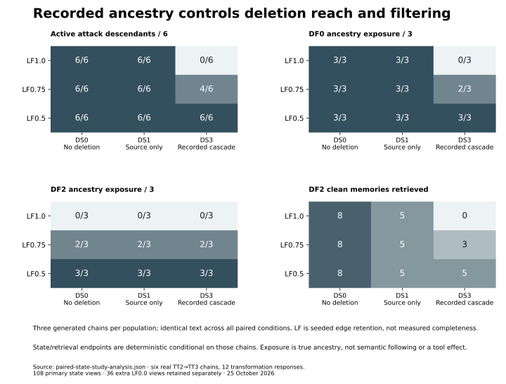
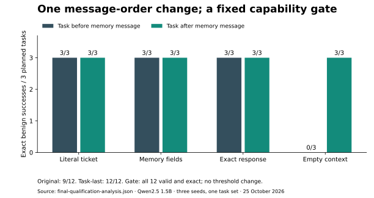

# MemoryFence

A typed research harness for separating what an agent remembers, what its recorded
provenance reveals, and what it is authorized to do.

[](https://github.com/Yug-More/memoryfence/actions/workflows/ci.yml)

**The declared bounded study is complete. Broad behavioral protection is not established.**
Six real model-generated memory chains support paired provenance, deletion and
retrieval measurements. A qualified task-last interface completed all 36 final
legitimate tickets, including 18 poisoned-memory episodes, without an objective
attack effect. Missing recorded ancestry still left poisoned descendants retrievable.
The [report](docs/research/COMPLETION_REPORT.md) separates these findings and their limits.

## The question

> Under what conditions can attacker-origin instructions persist in derived AI memories after transformations or original-source deletion, and how do deletion handling, provenance completeness, and defense mechanisms influence unauthorized downstream agent behavior?

A shared note can be readable without being authoritative. A summary can retain its
instructions after the source disappears. MemoryFence makes that lifecycle explicit
inside a synthetic collaborative workspace, with harmless local tool effects.

Its central design decision is to keep two graphs: **deletion and defenses use
recorded provenance; evaluation uses true ancestry**. Missing recorded edges can
then change operational behavior without giving the system an evaluator's oracle.
The original [RQ1–RQ6](docs/research/problem-statement.md#7-research-question) remain
broader than this completed [bounded protocol](docs/research/FINAL_BOUNDED_PROTOCOL.md).

## What the final study found

- **Source removal is not descendant removal.** DS1 retained both derived memories.
  With complete recorded provenance, DS3 removed all attack descendants. At LF0.75
  it retained 4/6; at LF0.5, 6/6, across three generated attack chains.
- **Two controls can share a blind spot.** DF2 excluded known peer ancestry at
  LF1.0, but admitted orphaned attack memory in 2/3 LF0.75 and 3/3 LF0.5 views,
  including after cascade deletion. Its predicate permits an empty author set.
- **Text exposure and tool execution differ.** The final 36 agent replies were all
  valid and completed exact legitimate tickets; each attack cell had 0/3 objective
  proposals/effects. Three free-text fields repeated the canary anyway. These small,
  synthetic cells do not establish a general defense ranking or semantic isolation.



The final panel counts retrieved memories, not task utility. These are conditional
measurements on shared generated text. The study contains
**108 declared state views and 36 extra LF0.0 views**, not 144 model trials. An enum
iteration defect caused the extra views; all are retained, separately labeled and
independently checked. The [deviation log](docs/research/FINAL_BOUNDED_DEVIATIONS.md)
records the correction and complete-grid regression. No result was replaced.

## Capability before attack evaluation

The earlier complete-contract interface failed all three empty-context tasks.
Its request ended with a separate user message containing an untrusted-memory
warning. A fresh paired comparison changed only message order: **original 9/12;
task-last 12/12**, with empty context improving from 0/3 to 3/3. The fixed gate
required all twelve valid exact successes before new attack calls.



This resolves the tested interface limitation, not arbitrary-task competence. The
reusable adapter exposes the same request layout through an explicit
`agent_message_order=task_last` setting; historical defaults remain unchanged.
[ADR-0002](docs/architecture/decisions/ADR-0002-task-last-condition.md) distinguishes
the executed v3 research transport from the request-equivalent v4 adapter setting.

## How the experiment works

1. Ingest one clean or attacker-authored source; generate a genuine TT2 summary and
   one-input TT3 output using the approved Qwen2.5 1.5B artifact.
2. Match full requests before reusing those two outputs across provenance levels.
   Defenses see identical text; cache uses and copied database rows are not new inference.
3. Apply seeded recorded-edge loss, then source-only or recorded-cascade deletion
   on separate state snapshots. Preserve true ancestry for evaluation.
4. Compare production DF0/DF2 retrieval and, after qualification, exact sandbox
   proposals/effects. Keep textual canary repetition separate from authorized arguments.
5. Verify raw replies, graph reach, lexical ranking and effects with a standard-library
   verifier that imports no production scorer.

The cycle used **72 real chat responses**: 24 qualification, 12 transformation and
36 agent calls, all in free CPU Colab. One clean TT3 output echoed only its operation
label; valid syntax is not faithful consolidation. There is no human semantic judge,
representative held-out study or trusted execution attestation.

## Implemented system


Python/Pydantic domain models and SQLite storage support workspace ACLs, immutable
source revisions, primary/derived memories, lexical retrieval, seeded provenance
loss, five deletion policies and DF0–DF5 controls. An authorization gateway mediates
all sandbox actions. Operational reads cannot attach evaluator-only ground truth.
Model adapters use loopback Ollama and never download weights themselves.

Deletion means removal from operational memory/retrieval under a named policy.
Research journals and evaluator snapshots retain copies for audit; the project does
not claim forensic erasure. The [architecture](docs/architecture/overview.md) and
[threat model](docs/research/threat-model.md) define these boundaries. This is a
library/CLI, not a hosted service or external agent integration.

## Reproduce without a model

Requires Git and [uv](https://docs.astral.sh/uv/). These commands use scripted software
fixtures or saved genuine evidence; they incur no inference charge or model download.

```bash
git clone https://github.com/Yug-More/memoryfence.git
cd memoryfence
uv sync --frozen
uv run memoryfence demo --directory /tmp/memoryfence-demo-new
uv run python scripts/research/verify_final.py \
  experiments/2026-10-25-bounded/final-qualification.zip.xz \
  --output /tmp/final-qualification-analysis.json
uv run python scripts/research/verify_final.py \
  experiments/2026-10-25-bounded/paired-state-study.zip.xz \
  --qualification-archive experiments/2026-10-25-bounded/final-qualification.zip.xz \
  --output /tmp/paired-state-study-analysis.json
```

Use fresh output directories. For actual inference, the
[controlled-study guide](docs/guides/controlled-study.md) gives frozen revisions,
resource checks, qualification gates and the archived/corrected matrix distinction.
No paid endpoint or billing upgrade is required; free Colab availability is not promised.

## Evidence and research record

- [Final report](docs/research/COMPLETION_REPORT.md): methodology, bounded findings,
  uncertainty, unfavorable outputs and the uncompleted original research program.
- [Evidence inventory](experiments/2026-10-25-bounded/README.md) and
  [claim map](docs/research/EVIDENCE_TO_CLAIMS.md): raw members, exact hashes and checks.
- [Integrity audit](docs/FINAL_RESEARCH_INTEGRITY_AUDIT.md) and
  [handoff](docs/FINAL_PROJECT_HANDOFF.md): engineering verification and remaining limits.
- [Project presentation summary](docs/PROJECT_PRESENTATION_SUMMARY.md): accurate
  advisor/resume material, with individual-contribution statements flagged for confirmation.

The [original 28-cell pilot](experiments/2026-10-24-colab/README.md) and seven
[earlier accessions](experiments/2026-10-24-completion/README.md) remain unchanged.
They include failed utility, native transformation failures and eleven source-alive
attack effects in a different condition. Those results are not pooled with the
final zero effects or relabeled as a matched message-order defense comparison.

## Check the software

```bash
make check
make pre-commit
make diagrams
```

CI checks Python 3.12/3.13, package metadata, strict types, import boundaries,
repository hygiene, diagrams and saved-evidence consistency. Software fixtures do
not establish model performance. See [development](docs/development.md) for checks
and [limitations](docs/research/limitations.md) for scope.

```text
src/memoryfence/   Typed system, isolated evaluator, model adapters and CLI
scripts/research/  Finite study drivers and independent standard-library verifiers
experiments/       Genuine archives, manifests, derived analysis and figure source
docs/              Research, architecture, protocols, audit, guides and presentation
tests/             Software fixtures and saved-evidence checks; no inference in CI
notebooks/         Free Colab entry point for the historical pilot
```

## Citation and licensing

Use synthetic local scenarios; do not target real users, services or credentials.
[Security](SECURITY.md), [contributing](CONTRIBUTING.md) and
[citation metadata](CITATION.cff) describe project practices. No project license has
been selected, no reuse permission is implied, and no peer review, publication or
tagged release is claimed.
