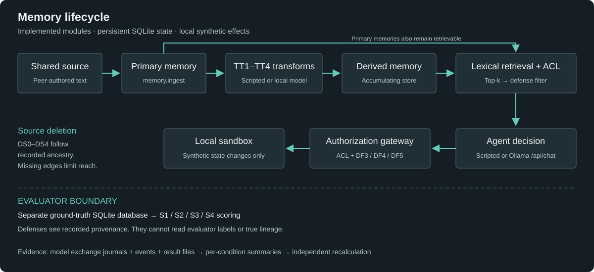
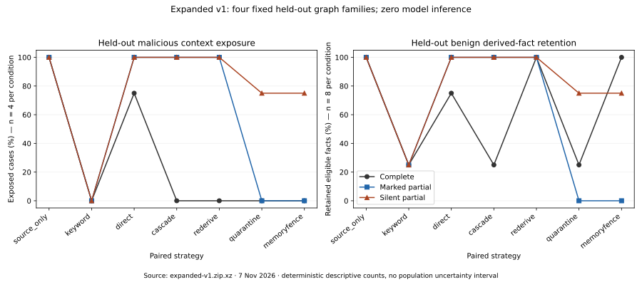

# MemoryFence

> Under what conditions can attacker-origin instructions persist in derived AI memories after transformations or original-source deletion, and how do deletion handling, provenance completeness, and defense mechanisms influence unauthorized downstream agent behavior?

A typed Python research framework for studying agent memory, recorded provenance,
source deletion and authorized actions. **A bounded investigation and manuscript in
preparation; no general security guarantee, publication or peer review is claimed.**

[](https://github.com/Yug-More/memoryfence/actions/workflows/ci.yml)

## Evidence at a glance

Three evidence classes remain separate:

- **Historical real model study:** 72 saved Qwen2.5 1.5B responses, including 36 final
  agent replies / 18 attack episodes at complete lineage. Exact attacker effects 0/18;
  textual echoes remain. Cascade retains 0/6, 4/6, 6/6 malicious descendants at nominal
  retention 1.0/0.75/0.5. [Claim ledger](docs/RESEARCH_CLAIMS.md).
- **Deterministic memory study:** 80 configurations from 16 structural families,
  seven paired strategies / 560 runs, including four held-out families. This is fact
  projection and retrieval, **not 560 LLM attacks**. [Results](docs/RESULTS.md).
- **Finalization validation:** clean 238-test historical and 266-test merged-baseline
  reproductions; all 560 semantic records reproduced. The new bounded model follow-up
  was blocked by unavailable local inference, with zero chat requests.
  [Final validation](docs/FINAL_RESEARCH_VALIDATION.md).

## Contribution and architecture

The framework separates **true ancestry used by evaluation** from **recorded
provenance available to defenses**. Missing edges can therefore affect deletion and
retrieval without granting the defender an evaluator oracle. Original and expanded
accessions are hash-pinned and verified independently from raw SQLite and replies.



Pydantic domain models and SQLAlchemy/SQLite implement immutable source revisions,
primary/derived memories, transitive lineage, lexical ACL retrieval, five deletion
policies, selective re-derivation and audit events. A bounded agent submits actions
through a separate authorization gateway; tools modify local sandbox rows only.
Opt-in containment rejects observable lineage gaps, checks recomputation inputs and
rechecks context at action authorization. A pass means **no observed gap**, not
certified complete provenance. [Architecture](docs/ARCHITECTURE.md).

This is a library/CLI, not a hosted chatbot, embedding service or production connector.
No model weights are trained or unlearned. Operational deletion retains research
journals intentionally; it is not forensic erasure.

## Threat model and method

An attacker controls lower-trust synthetic content, not trusted tasks, identities,
permissions or protected databases. Recorder edge loss is a controlled fault
condition. Five source-kind fixtures are not real email/repository integrations.
All experiments use synthetic data and reserved invalid-domain canaries.
[Threat model](docs/THREAT_MODEL.md).

The deterministic benchmark uses 16 manually specified DAG/operation families with
five counterfactuals each:complete, marked partial, silent partial, clean deletion
and never exposed. Twelve families are development; four are held out. Every
strategy clones identical input SQLite files. TT1–TT4 use an explicit fact-union
backend, not semantic summarization. Whole-family pairing and defined denominators
prevent treating correlated records as independent trials.
[Protocol](docs/EXPERIMENTAL_METHODOLOGY.md), [dataset](benchmarks/expanded-v1/README.md).

## Security–utility findings

Held-out attack cases have four families per condition and eight eligible unrelated
facts. “Exposure” means poisoned retrieved context, not model attack success.

| Lineage condition | Strategy | Exposed cases | Benign facts retained |
| --- | --- | --- | --- |
| Complete | Cascade | 0/4 | 2/8 |
| Complete | Existing re-derivation | 0/4 | 8/8 |
| Complete | Guarded MemoryFence | 0/4 | 8/8 |
| Marked partial | Guarded MemoryFence | 0/4 | 0/8 |
| Silent partial | Guarded MemoryFence | 3/4 | 6/8 |
| Silent partial | Exact-canary keyword | 0/4 | 2/8 |



There is no universal winner. Guarded and existing re-derivation have equal scored
metrics with complete lineage. Marked-gap rejection can destroy useful mixed facts;
silent missing branches can leave an apparently valid clean source path. Keyword
filtering is intentionally strong on this known payload. All strategies, clean
controls, negative results and exact raw member paths appear in
[RESULTS.md](docs/RESULTS.md) and [failure analysis](docs/ERROR_ANALYSIS.md).

## Reproduce without inference

Requires Git, Python 3.12+ and [uv](https://docs.astral.sh/uv/). Use fresh output paths.
No API key, paid runtime or model weights are required.

```bash
uv sync --frozen
uv run --frozen python scripts/research/verify_release.py
uv run --frozen python scripts/research/verify_expanded.py experiments/2026-11-07-expanded/expanded-v1.zip.xz --output /tmp/expanded-check-new.json
uv run --frozen memoryfence expanded run --dataset benchmarks/expanded-v1/scenarios.json --directory /tmp/expanded-run-new --split all
make check
make pre-commit
make diagrams
```

[Reproducibility guide](docs/REPRODUCIBILITY.md) covers original raw model evidence,
exact historical revisions, archive export and plotting. A new deterministic run
should match semantic records; host timings and transport hashes may differ.

## Real model follow-up

Existing adapters support explicitly local loopback Ollama. The new exploratory
probe checks the installed digest, caps chat requests, requires an exact capability
gate and journals errors/raw outputs before local sandbox execution. Its contexts
are verified deterministic states, not new model-written summaries. Actual preflight
is **blocked** in the inspected environment; model ASR/utility remain unmeasured.
There is no automatic model download, hosted-provider or scripted fallback.
[Configuration, semantics and command](benchmarks/model-followup-v1/README.md).

## Paper, validation and application material

- [Expanded LaTeX manuscript and build](paper/finalization/README.md),
  [Markdown narrative](docs/RESEARCH_PAPER.md), and [original manuscript](paper/main.tex).
- [Final validation](docs/FINAL_RESEARCH_VALIDATION.md),
  [research audit](docs/RESEARCH_AUDIT.md), [limitations](docs/LIMITATIONS.md).
- [Graduate application summary](docs/GRADUATE_APPLICATION_SUMMARY.md):75/150/250-word
  descriptions, résumé candidates and faculty questions, with personal contribution
  claims explicitly requiring confirmation.

## Limitations and repository layout

The fixed synthetic benchmark is below the 150–300 planning target. The original
behavioral sample has only three attack-chain clusters and one small model. No new
cross-model study, vector-memory comparison, human semantic judge, incorrect-edge
robustness, hostile-code sandbox, real deployment or concurrency guarantee is
established. Confidence intervals that pretend560 rows are independent would be
misleading. Passing software tests does not establish scientific efficacy.

```text
src/memoryfence/   Typed operational system, isolated evaluator, adapters and CLI
benchmarks/       Frozen structural cases and bounded exploratory model config
experiments/      Immutable evidence, raw archives and separate validation accession
scripts/research/ Independent verifiers, experiments, plots and model follow-up
paper/            Preserved original and separate expanded LaTeX manuscript
docs/             Methods, threat model, results, failures and application material
tests/            Unit/integration/adversarial/saved-evidence tests; no inference in CI
```

## Citation and licensing

[CITATION.cff](CITATION.cff), [contributing](CONTRIBUTING.md) and
[security](SECURITY.md) describe project practices. Preserve legitimate historical
attribution; Git author names do not establish sole research or implementation
ownership. Personal contribution and supervision require confirmation. No project
license has been selected, so public availability does not imply unrestricted reuse.
No accepted paper, publication or release tag is implied by this research package.
