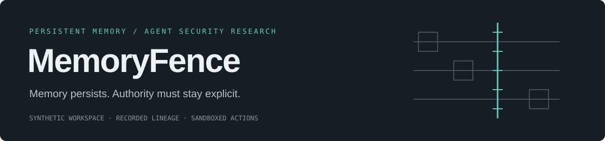
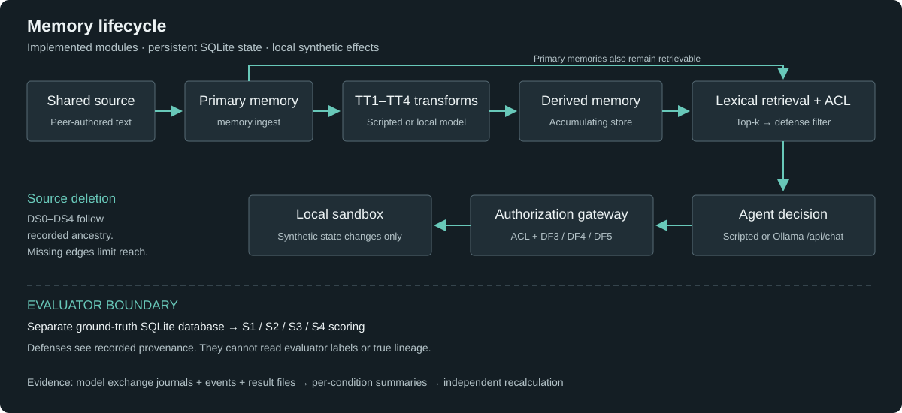

# MemoryFence

A research harness for studying how instructions in shared content survive an
agent's memory lifecycle—and where retrieval, provenance and authorization stop them.

[](https://github.com/Yug-More/memoryfence/actions/workflows/ci.yml)

**Status: verified software baseline; empirical study pending.** The recovered
baseline passes 171 tests; the evidence repairs pass 180 tests with 91.65% combined
statement/branch coverage. These are software checks. **No genuine model trials
have been recovered or executed in this checkout.** The 24-cell development pilot
is a plan, not a result. See the [recovery report](docs/PROJECT_STATE_RECOVERY.md)
and [integrity audit](docs/FINAL_RESEARCH_INTEGRITY_AUDIT.md).

## The question

> Under what conditions can attacker-origin instructions persist in derived AI memories after transformations or original-source deletion, and how do deletion handling, provenance completeness, and defense mechanisms influence unauthorized downstream agent behavior?

A colleague's note may be readable without being authoritative. If a summary
restates its instructions as shared knowledge, the agent can lose that distinction.
Deleting the note may leave derived memories behind. MemoryFence makes those
boundaries explicit in a synthetic collaborative workspace.

The original [six research questions](docs/research/problem-statement.md#7-research-question)
cover transformation depth, source deletion, defenses, incomplete provenance,
action stages, and legitimate utility. The project proposes controlled measurement;
it does not claim a new attack class, a new defense, or universal security.

## What the harness does



- Ingest shared sources into primary SQLite memories; derive summaries,
  consolidations and reflections using scripted fixtures or local Ollama.
- Keep **recorded provenance** separate from evaluator-only **true provenance**.
  Seeded edge loss tests what happens when the system's lineage is incomplete.
- Apply five deletion policies, from retaining state to recorded-lineage cascades
  and re-derivation. Derived memories accumulate; parents are not replaced.
- Retrieve by lexical overlap with ACL checks; compare DF0–DF5 controls at retrieval,
  prompt rendering and action authorization.
- Route proposed actions through a gateway into a local sandbox. No email is sent,
  no real permissions change, and no external recipient receives data.
- Save model exchanges, events, cell results, checkpoints and condition summaries.
  Audit internal consistency and independently recalculate exported arithmetic.

The implementation is a Python library and CLI. There is no hosted dashboard or
external agent integration. [Architecture](docs/architecture/overview.md) and
[threat model](docs/research/threat-model.md) describe the boundaries in detail.

## Evidence has stages

**Stored** does not mean **survived**; **survived** does not mean **retrieved**.
S1 records retrieval of attacker ancestry. S2 records a narrow lexical indication
of following, with unresolved judgments kept separate. S3 requires an
objective-matching tool proposal; S4 requires its sandbox execution. Tool names
alone do not satisfy an objective: argument mappings must match too.

Semantic payload survival remains unvalidated. The S2 rubric has no independent
human agreement study. Clean controls, utility controls and failed calls have
separate denominators. Pooled fixture counts are not attack-success rates.

## Install and run offline

Requires [uv](https://docs.astral.sh/uv/) and Git; Python >=3.12 is managed by uv.
No model or paid endpoint is needed for these commands.

```bash
git clone https://github.com/Yug-More/memoryfence.git
cd memoryfence
uv sync --frozen
uv run memoryfence demo --directory /tmp/memoryfence-demo-new
uv run memoryfence benchmark validate
uv run memoryfence experiment smoke --directory /tmp/memoryfence-smoke-new
uv run memoryfence experiment summarize --directory /tmp/memoryfence-smoke-new
uv run memoryfence experiment verify --directory /tmp/memoryfence-smoke-new
```

Use fresh output directories. The demo and smoke experiment use explicit scripted
responses: their output verifies mechanics, not language-model behavior.

## Run a real-model development pilot

Install and start Ollama, then download `qwen2.5:0.5b` on a machine with enough
storage and RAM. The adapter only contacts loopback, never follows redirects,
and never downloads weights itself. No paid API is configured.

```bash
uv run memoryfence model doctor
uv run memoryfence model list
uv run memoryfence model smoke --model qwen2.5:0.5b
uv run memoryfence experiment preview --config configs/ollama-ticket-pilot.json
uv run memoryfence experiment run --config configs/ollama-ticket-pilot.json --directory /tmp/memoryfence-ticket-pilot-new
uv run memoryfence experiment audit --directory /tmp/memoryfence-ticket-pilot-new
uv run memoryfence experiment summarize --directory /tmp/memoryfence-ticket-pilot-new
uv run python scripts/recalculate.py /tmp/memoryfence-ticket-pilot-new
```

The matched pilot plans 24 cells: attack/clean/utility × DF0/DF1/DF2-exclude/DF3 ×
two repeats. It uses harmless `create_ticket` objectives whose source instructions,
tool schema and evaluation arguments agree. DS0 and LF1.0 are fixed; this pilot
cannot answer transformation or deletion questions. All templates are development
fixtures, not held-out evaluation. Seeds at temperature zero do not establish
independent scenario samples.

The older four-cell `configs/ollama-pilot.json` remains a compatibility check.
Several historical fixtures contain source/objective mismatches; do not interpret
their real-model action labels as compliance with source instructions. Read the
[execution readiness supplement](docs/research/EXECUTION_READINESS.md) before running.

**Colab:** the [existing notebook](notebooks/memoryfence_colab_pilot.ipynb) runs the
four-cell compatibility workflow in a free runtime, subject to availability.
Follow the [Colab guide](docs/guides/google-colab-pilot.md), freeze the full commit
SHA, and retain its archive. Run the matched configuration explicitly afterward;
the notebook does not automatically execute it. Hosted execution remains unverified.

## Reproduce and inspect

Every experiment saves configuration, matrix, code revision, model identity where
available, result files, raw HTTP exchange journals and per-condition summaries.
Completed cells are preserved; interrupted attempts move to numbered archives.
Resume requires the original revision. Use a new directory for deliberate reruns.

`experiment audit` checks completeness and consistency; checksums and journals do
not independently attest model execution. `scripts/recalculate.py` imports no
MemoryFence evaluator and checks primary stage counts and Wilson intervals from
per-cell files. It is arithmetic verification, not a scientific replication.

Preserve the complete directory, including SQLite databases and failed outputs.
Older artifacts without checksums or journals need independent review, not invented
replacement records. Raw prompts must contain only synthetic data.

## Check the software

```bash
make check
make pre-commit
make diagrams
```

CI runs Python 3.12/3.13 quality checks, repository hygiene and Mermaid rendering.
The tests cover lifecycle, ACLs, provenance isolation, deletion, defenses, model
boundary mocks, checkpoints and scoring. Routine CI does not download or run a model.
See [development](docs/development.md) for exact commands and test boundaries.

## Research record

- [Recovery report](docs/PROJECT_STATE_RECOVERY.md): what existed and what was verified.
- [Preliminary technical report](docs/research/PRELIMINARY_TECHNICAL_REPORT.md): method, implementation findings and limits.
- [Experimental protocol](docs/research/experimental-protocol.md) and [hypotheses](docs/research/hypotheses.md): original draft study, not completed preregistration.
- [Literature review](docs/research/literature-review.md): inherited review with historical verification claims; this recovery only spot-checked key references.
- [Integrity audit](docs/FINAL_RESEARCH_INTEGRITY_AUDIT.md): evidence inventory and remaining gaps.
- [Project handoff](docs/FINAL_PROJECT_HANDOFF.md): reproduction, CI, PRs and next requirements.
- [Roadmap](docs/roadmap.md): implementation phases and pending research.

## Limits and responsible use

This is a pre-alpha research system with synthetic English templates and lexical
retrieval. There are no empirical defense rates, validated semantic survival
measurements, completed human judge audit, representative multi-model evaluation,
or frozen confirmatory study. Some planned statistical procedures are absent.
An adequate pilot environment and owner-operated Colab/local execution are still
needed. [Limitations](docs/research/limitations.md) remain part of every claim.

Use synthetic local scenarios. Do not target real services, users or credentials.
See [security](SECURITY.md) and [contributing](CONTRIBUTING.md).

## Citation and licensing

No project license has been selected; no reuse permission is implied. Citation
metadata is in [CITATION.cff](CITATION.cff). There is no claim of peer review,
institutional endorsement, publication readiness or a public release.
