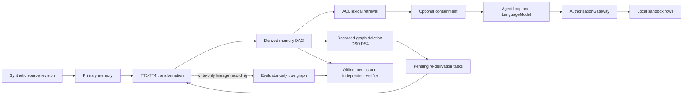

# Architecture — research framework and opt-in containment

7 November 2026. This document describes the current implementation. The older
[phase overview](architecture/overview.md) includes historical/planned material;
its stale “does not exist yet” statements are not the current feature inventory.
No frontend, web API, vector database, embeddings, LangChain, agent swarm or model
training is implemented. The application is a typed Python library and CLI.

## Data and trust boundaries

`domain` defines frozen Pydantic models, enums and protocols. SQLAlchemy maps two
SQLite files (`storage/schema.py`, `storage/database.py`). `system.sqlite` holds
principals, workspace memberships, source revisions, primary/derived memories,
transformations, recorded provenance, deletion requests, re-derivation tasks,
model-call records and audit events. `groundtruth.sqlite` holds true lineage,
source-origin labels and evaluator deletion/run metadata. Recorded nodes survive
memory deletion; true graph rows are append-only. Deleting operational content
retains forensic research evidence, not erasure from disk or model weights.

The writer uses attached databases with rollback journals and FULL synchronization.
Defense reads use `EpisodeDatabase.system_read_session`: a read-only connection to
only the system file. Import-linter's six contracts prohibit operational modules
from importing evaluator modules. This protects the experiment's measurement
boundary for trusted Python code; it is not a hostile-code sandbox or enclave.
See `tests/test_persistence.py`, `tests/test_provenance.py` and the contracts in
`pyproject.toml`. Transaction failure tests are not crash-durability certification.

## Existing lifecycle and security

`workspace/sources.py:SourceService` creates immutable revisions. `workspace/memories.py:MemoryService`
extracts primary memories. `memory/transforms.py:TransformService` obtains actual
parent context, calls `LanguageModel`, validates output and records true and
recorded dependencies. TT1–TT4 are operation contracts; in the expanded projection
backend they all union supplied facts, **not four different semantic algorithms**.
`provenance/degradation.py` seeds nested recorded-edge loss; true edges stay intact.
`provenance/recorded.py:RecordedProvenanceReader` provides transitive operational views.

`workspace/deletion.py:DeletionService.apply` implements DS0 no-op, DS1 source and
primary removal, DS2 tombstoning, DS3 recorded-descendant invalidation and DS4
invalidation with re-derivation scheduling. `memory/rederive.py:RederivationExecutor`
resolves surviving input/replacement IDs in dependency order, never deleted text or
true lineage. Completed tasks are idempotent; an operation failure leaves pending
work retryable. New expanded whole-run execution intentionally refuses an existing
directory and does not yet resume partial matrices.

`access/policy.py` and `workspace/authority.py:Authorizer` enforce requester,
workspace role, ownership/visibility and delegated-agent constraints. These are
in-process identity and authorization controls, **not deployed login/OAuth**.
`memory/retrieve.py:RetrievalService.retrieve` filters readable active memories then
ranks lexical matches. Defenses can filter/language-label context; a readable note
is not automatically authority for a task. `agents/loop.py:AgentLoop` proposes one
bounded action. `authorization/gateway.py:AuthorizationGateway` checks propose and
execute independently; model rationale is not an authorization input.
`tools/sandbox.py` implements only local ticket/task/note effects, not network tools.

## New observable-lineage containment

`defenses/containment.py:ContainmentGuard.assess` first enforces MEMORY_READ and then
uses recorded metadata only. It rejects marked-incomplete ancestry, a derived
orphan without source roots, unavailable source ancestry and unavailable lineage.
A pass is named `no_observed_gap`, never “complete provenance”. `filter` records
kept/excluded IDs and reasons in an audit event without logging raw content.

`GuardedTransformBackend` checks every supplied re-derivation input before the
backend executes. `ContainedDefense` is an opt-in `DefenseSuite` adapter for existing
AgentLoop/gateway hook points, combining normal filtering with containment and
rechecking context at action authorization. Legacy defaults and schemas remain
unchanged. It narrows observed lifecycle gaps; it does not guarantee race-free
concurrent action execution or sanitize arbitrary malicious language.

The expanded `memoryfence` strategy composes production DS4, guarded recomputation
and retrieval containment. `rederive` disables the guard; `quarantine` disables
recomputation. At complete recorded lineage, the proposed method can equal existing
DS4. When a silent missing malicious branch leaves an active clean source path,
the guard may accept poisoned content: no operational evidence proves a missing
edge. See `tests/test_expanded.py` marked/silent regressions and [results](RESULTS.md).

## Reproducible evaluation

`evaluation/expanded/dataset.py` validates DAG order, controls and grouped split
signatures. `runner.py` builds one input per case, closes it, clones both SQLite
files for each strategy and hash-shuffles strategy order. `ProjectionBackend`
performs deterministic fact union with no inference. `report.py` collapses paired
case deltas within families. The independent stdlib
`scripts/research/verify_expanded.py` opens archived SQLite bytes read-only, derives
reach/ranking/fact metrics without importing production scoring and checks recorded
outputs. A ZIP/XZ archive contains full raw input/after pairs, not just summary rows.

Existing loopback Ollama adapters and raw request journals remain available; the
Expanded Study does not use them. Original model-backed and new deterministic
evidence have separate accessions and interpretations.

## Compared representations and finalization — 8 November 2026

The historical genuine experiment transforms natural-language memory with one local
model; the expanded benchmark uses structured JSON fact records projected through
the same services. Raw primary source text, derived memory and reconstructed memory
exist, but **no matched architecture-wide comparison** of conversation history,
vector RAG, semantic summaries and key-value stores has been performed. Provenance
and uncertainty are metadata/control variants of the existing store, not separate
production architectures invented for this release.

Finalization adds declared-grid/fraction validation before summary generation,
CLI domain errors for malformed artifacts, path-safe scenario IDs and symlink-free
export. `scripts/research/model_followup.py` implements a bounded exploratory
state-to-action probe with preflight identity, capability gate, durable HTTP evidence,
atomic result checkpoints and actual local gateway effects. It has no resume,
hosted provider or model-download path. The availability check is blocked. Model
outputs, exact evaluator predicates and research interpretation remain separate.
