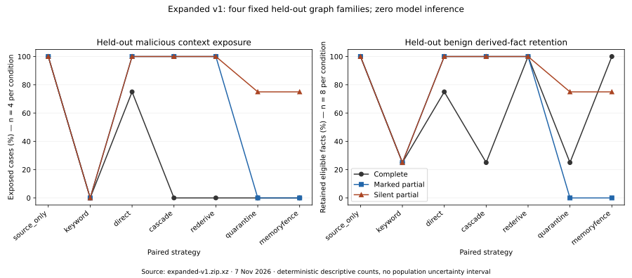
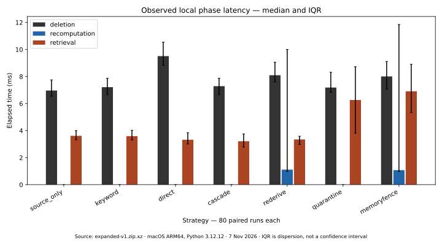

# Results — Original Study and Expanded Study v1

7 November 2026. Raw evidence, complete count tables and software checks are
separate. **No new model inference occurred.** New behavioral metrics are null.

## Original Study: preserved and independently recomputed artifacts

The [historical ledger](RESEARCH_CLAIMS.md) maps every application-relevant claim to
its exact conditions. All 53 manifest-pinned files still match original SHA256/size.
The saved qualification and state verifiers were rerun; analysis JSON matched the
committed outputs byte for byte. This verifies supplied evidence, not a fresh model
replication. A separate pinned Git checkout reproduced 238 tests/91.58% coverage.

Final bounded inference: 24 qualification +12 transformation +36 agent responses.
The 36 final agent responses comprise 18 clean and 18 attack episodes at LF1.0;
all completed exact legitimate effects, with zero exact attacker objective effects
in 18 attack episodes. Three free-text fields still echoed the canary. Three attack
chains each have two descendants: DS3 retained 0/6 at LF1.0, 4/6 at nominal LF0.75,
6/6 at nominal LF0.5. Nominal 0.5 is a seeded edge-retention parameter, not exactly
50% realized coverage in every chain. One clean TT3 lost useful text. The 108 declared
state views and 36 extra off-protocol LF0.0 views are preserved separately.

Evidence: `experiments/2026-10-25-bounded/{final-qualification,paired-state-study}.zip.xz`,
corresponding analysis JSON, and `scripts/research/verify_final.py`. No incomplete-
provenance behavioral conclusion follows from those LF1.0-only agent episodes.

## Expanded execution and exact evidence

Protocol commit `9d56faa`; code/dataset execution commit
`4a430fa9939b1fa6438c64508368006e1e8b3fc6`. 80 cases, 16 fixed structural families,
seven paired strategies: **560 completed /560 planned, zero invalid**. Development:
12 families/60 cases/420 runs. Held-out evaluation: four families/20 cases/140 runs.
Each family has five counterfactual conditions, not five independent family draws.

[Accession](../experiments/2026-11-07-expanded/README.md): `expanded-v1.zip.xz` contains
`dataset.json`, `manifest.json`, `records.json`, `summary.json` and
`runs/{scenario_id}/input/{system.sqlite,groundtruth.sqlite,input.json}` plus each
strategy's `{system.sqlite,groundtruth.sqlite,result.json}`. Every result includes
metric counts, selected IDs, timings and status. The independent verifier checks
all 560 records from raw state. Complete pooled count tables:
[derived counts](../experiments/2026-11-07-expanded/derived/count-tables.md).
All metric numerator/denominator pairs also remain in raw records.

## Held-out security/utility tradeoff

Each row pools one condition across **four families**. Accessible originals count
true target-dependent original derived IDs still allowed; target facts additionally
check replacements. Exposure is malicious content in top-five derived context,
**not behavioral attack success**. Benign facts are unique within case, pooled
across cases; fact lookup has one eligible target per case. All strategies share
the same input and derived-only answer workload.

| Condition | Strategy | Accessible originals | Target facts accessible | Exposed cases | Benign facts retained | Fact lookups |
| --- | --- | --- | --- | --- | --- | --- |
| Complete | source_only | 11/11 | 4/4 | 4/4 | 8/8 | 4/4 |
| Complete | keyword | 0/11 | 0/4 | 0/4 | 2/8 | 1/4 |
| Complete | direct | 7/11 | 3/4 | 3/4 | 6/8 | 3/4 |
| Complete | cascade | 0/11 | 0/4 | 0/4 | 2/8 | 1/4 |
| Complete | rederive | 0/11 | 0/4 | 0/4 | 8/8 | 4/4 |
| Complete | quarantine | 0/11 | 0/4 | 0/4 | 2/8 | 1/4 |
| Complete | memoryfence | 0/11 | 0/4 | 0/4 | 8/8 | 4/4 |
| Marked partial | source_only | 11/11 | 4/4 | 4/4 | 8/8 | 4/4 |
| Marked partial | keyword | 0/11 | 0/4 | 0/4 | 2/8 | 1/4 |
| Marked partial | direct | 11/11 | 4/4 | 4/4 | 8/8 | 4/4 |
| Marked partial | cascade | 11/11 | 4/4 | 4/4 | 8/8 | 4/4 |
| Marked partial | rederive | 11/11 | 4/4 | 4/4 | 8/8 | 4/4 |
| Marked partial | quarantine | 0/11 | 0/4 | 0/4 | 0/8 | 0/4 |
| Marked partial | memoryfence | 0/11 | 0/4 | 0/4 | 0/8 | 0/4 |
| Silent partial | source_only | 11/11 | 4/4 | 4/4 | 8/8 | 4/4 |
| Silent partial | keyword | 0/11 | 0/4 | 0/4 | 2/8 | 1/4 |
| Silent partial | direct | 11/11 | 4/4 | 4/4 | 8/8 | 4/4 |
| Silent partial | cascade | 11/11 | 4/4 | 4/4 | 8/8 | 4/4 |
| Silent partial | rederive | 11/11 | 4/4 | 4/4 | 8/8 | 4/4 |
| Silent partial | quarantine | 5/11 | 3/4 | 3/4 | 6/8 | 3/4 |
| Silent partial | memoryfence | 5/11 | 3/4 | 3/4 | 6/8 | 3/4 |

Physical survival differs from accessibility: in held-out marked and silent
conditions **all 11/11 target originals remain physically active** under cascade,
rederive, quarantine and memoryfence; quarantine is a retrieval intervention.
The new guard does not make this deletion-complete. With complete lineage,
rederive and memoryfence are **equal on every scored metric**, including benign
retention, across all 16 attack-complete cases; do not claim algorithmic superiority.

Marked held-outs remove exposure but lose **8/8 eligible benign facts**. Missing
recorded target edges prevent DS4 scheduling any affected task in these four cases;
there is no safe recovery by inventing true links. Silent held-outs f14, f15 and
f16 retain active clean-root paths, so `no_observed_gap` admits poisoned mixed
memories. Their allowed IDs/results are at
`runs/exp-v1-f{14,15,16}-attack_silent/memoryfence/result.json` in the archive;
f13 is rejected as an orphan. No held-out tuning followed these findings.

Exact-canary keyword filtering achieves 0/4 exposure in all three attack conditions,
retaining 2/8 benign facts. It is an intentionally strong payload-aware baseline;
the new method does not dominate it under silent loss. Paraphrase robustness was
not measured. Clean complete-source deletion shows the same cascade/re-derivation
utility tradeoff without an attack. Never-exposed held-outs preserve all 8/8 benign
facts and 4/4 lookups under every strategy, with no malicious context exposure;
attack eligibility is 0/0, not a zero ASR. Target-original persistence is also 0/0.

## Development and ablations

For 12 attack families: source-only exposes 12/12 in each lineage condition.
Cascade exposes 0/12 complete, 9/12 marked and 9/12 silent. MemoryFence exposes
0/12 complete, 0/12 marked and 3/12 silent. Benign retention among eligible
mixed-source development cases is respectively 7/7, 3/7 and 5/7 for MemoryFence;
quarantine without recomputation yields 2/7, 2/7 and 4/7. The five purely target-
derived families have no benign-derived fact denominator and remain undefined.

Ablations are actual strategy differences: direct-only versus transitive deletion;
DS4 without containment (`rederive`); containment without recomputation (`quarantine`).
The guarded-input rejection path is unit-tested but **no final matrix record reports
a blocked re-derivation input**, so its separate empirical benefit is not established.
No independent metadata-only or action-gate behavioral ablation was performed.

`summary.json::paired_family_deltas` averages eligible case differences inside each
family first. Across all five held-out controls, MemoryFence minus cascade benign
retention has family-macro delta +0.05 (family range −0.20 to +0.20; four families).
Against unguarded rederive it is −0.25 (range −0.40 to −0.20). These descriptive
all-control contrasts are not the complete-only +6/8 pooled fact difference or
significance tests. The table and raw per-condition counts prevent hiding that
composition effect.

## Efficiency and uncertainty

One local macOS14.5 ARM64/Python3.12.12 execution, 19:21:45–19:22:11 UTC on
7 November. Pydantic2.14.1, SQLAlchemy2.1.5, frozen dependency hash in manifest.
Observed medians: input build 46.090ms/80 inputs; source create+extract 5.063ms/240
source observations. Per-strategy 80-run medians (deletion/recomputation/retrieval):
source_only 6.963/0.001/3.609ms; cascade 7.286/0.001/3.212ms; rederive
8.096/1.111/3.342ms; memoryfence 8.009/1.073/6.906ms. Non-recomputing phases include
small instrumentation overhead; they do not generate memories. Guarded retrieval
includes audit writes. SQLite pairs are 348160–356352 bytes per after-state; this
is not a matched provenance-storage overhead estimate or peak process RAM.

[Aggregates](../experiments/2026-11-07-expanded/derived/aggregates.json) provide all
metric counts, medians, inclusive IQR, minima and maxima. Strategy order is
hash-shuffled, but caches/hardware and mixed workloads confound performance
comparisons. No costed production performance or general overhead claim is made.
Model calls, tokens and inference cost: zero new calls; no model token use measured.

This is a finite fixed deterministic design. Exact fixture outcomes, descriptive
family ranges and paired contrasts are appropriate; binomial confidence intervals
or p-values treating 560 records as independent would misrepresent uncertainty.
No new ASR, unauthorized-tool rate, LLM task utility or cross-model generalization
is established. The [limitations](LIMITATIONS.md) describe what remains incomplete.
