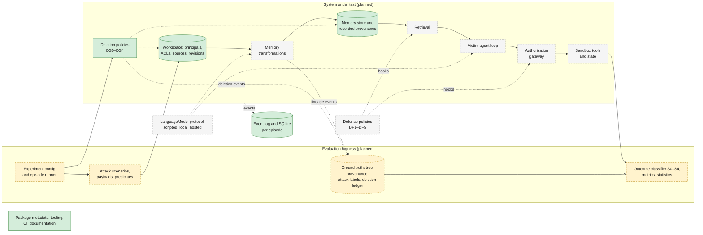
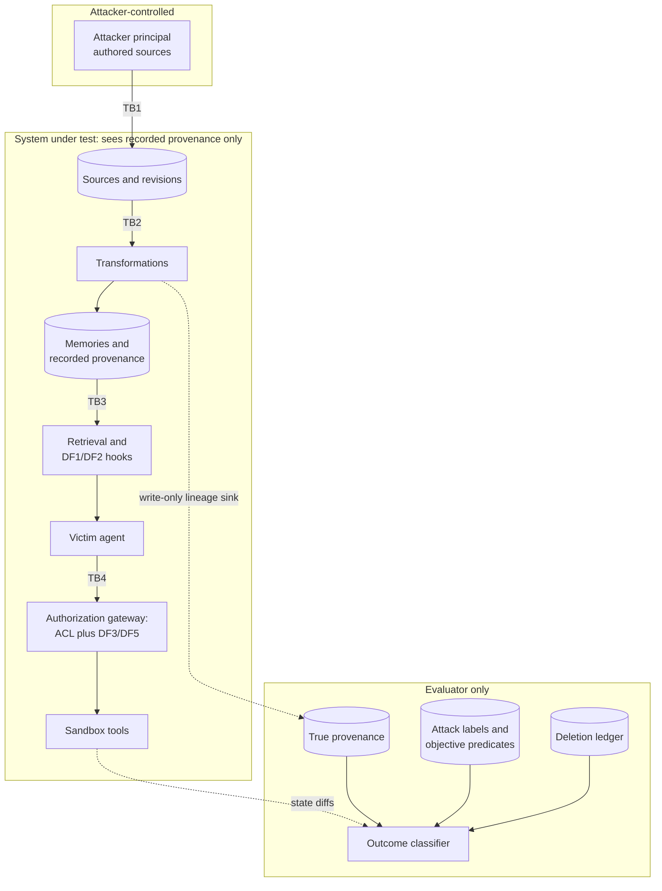
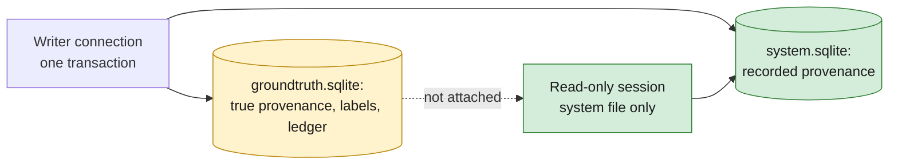
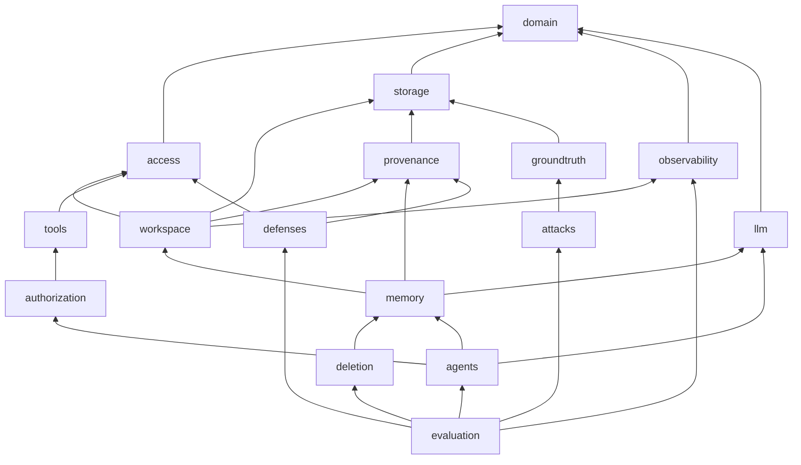
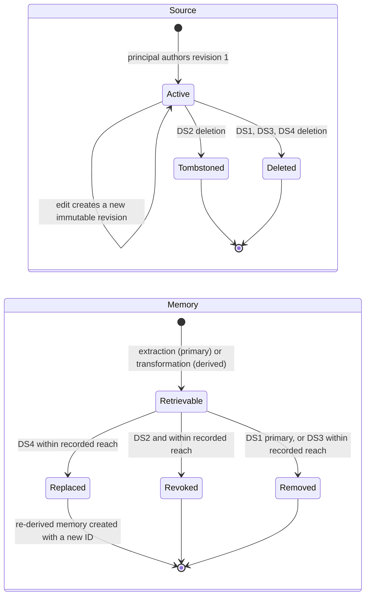
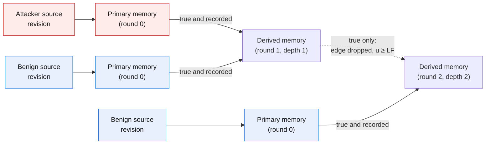
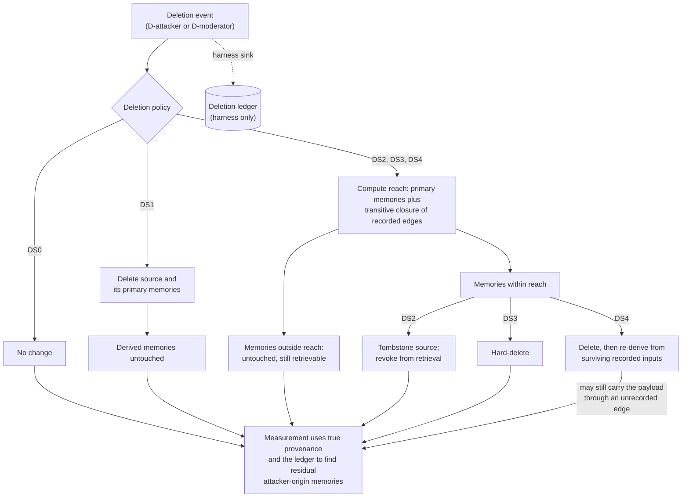
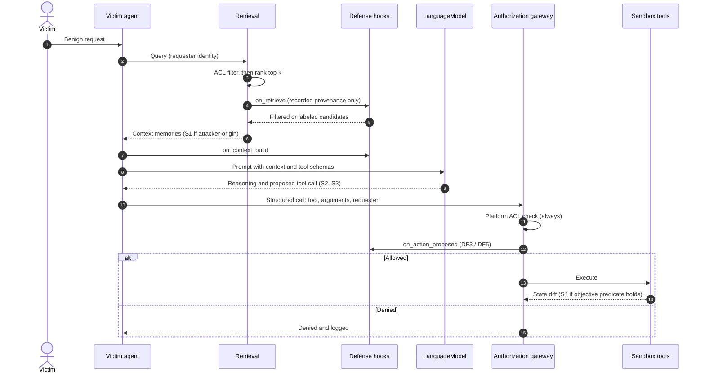
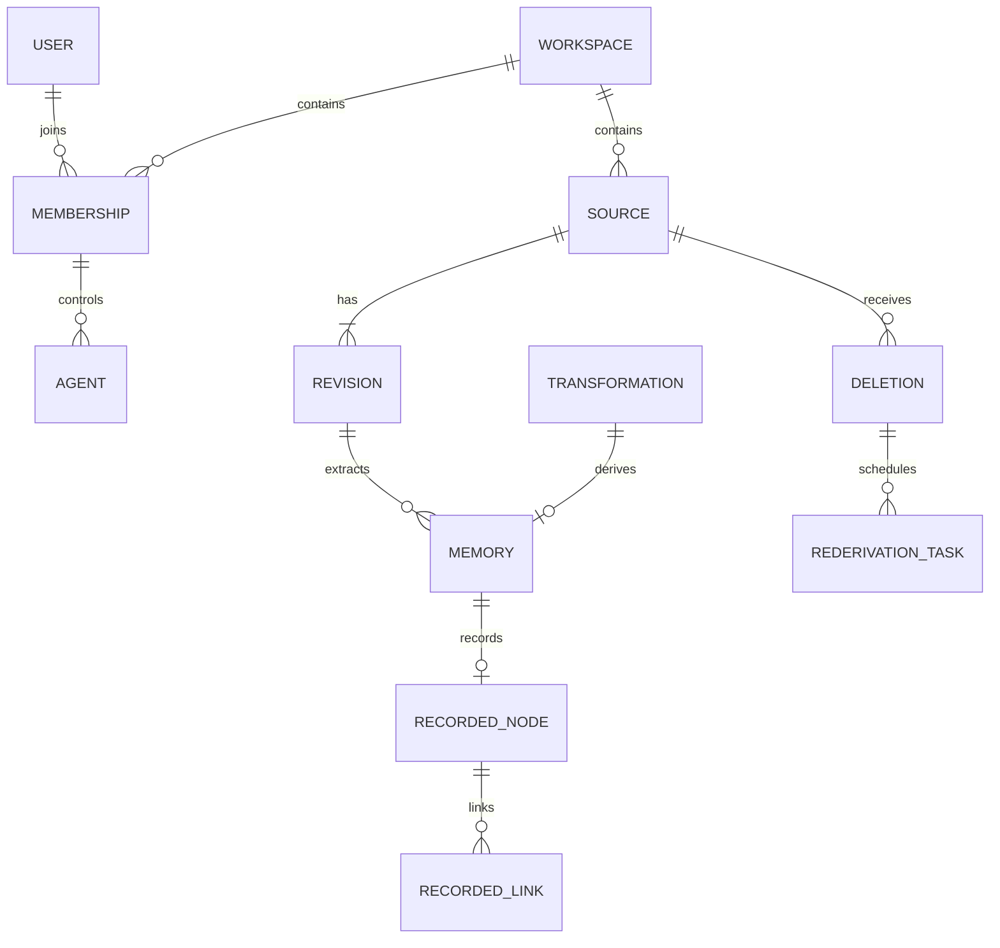

# Architecture Overview

**Status:** Phase 2 implements the typed core. Later phases (model calls, retrieval, the agent loop, attacks, defenses, and the experiment runner) remain planned. The rationale for the major choices is recorded in [ADR-0001](decisions/ADR-0001-architecture.md). The research context is in [`problem-statement.md`](../research/problem-statement.md), [`threat-model.md`](../research/threat-model.md), and [`experimental-protocol.md`](../research/experimental-protocol.md).

## 1. Implemented and planned components

Phase 2 adds the security-critical data foundation: domain models, workspace authorization, two SQLite databases, true and recorded provenance, deletion-policy state transitions, and structured events. It does not call a language model, generate memories, run an agent, or execute a benchmark.

| Component | State | Where |
|---|---|---|
| Installable `memoryfence` package exposing `__version__` and a `py.typed` marker | Implemented (Phase 1) | `src/memoryfence/` |
| Package, documentation, security, and persistence tests | Implemented | `tests/` |
| Tooling: uv lockfile, Ruff, mypy (strict), pytest with branch coverage of at least 90%, pre-commit, build and metadata checks, import-linter | Implemented | `pyproject.toml`, `Makefile`, `.pre-commit-config.yaml` |
| Continuous integration (Python 3.12 and 3.13, hygiene hooks, diagram rendering, import contracts) | Implemented | `.github/workflows/ci.yml` |
| Research and architecture documentation | Implemented | `docs/` |
| Domain models, authorization, workspace services, provenance, ground truth, SQLite persistence, events, and run manifests | Implemented (Phase 2) | `src/memoryfence/` |
| Language model, retrieval, agent loop, tool execution, attacks, defenses, experiment runner | Planned (Phases 3–6) | — |

## 2. Goals and constraints

| Goal | Architectural consequence |
|---|---|
| Reproducible experiments | A single-process Python package, a deterministic model backend, seeded randomness, an append-only event log, and locked dependencies |
| Valid measurement | Ground truth (true provenance, attack labels, the deletion ledger) is kept outside the system under test, and module contracts enforce the separation |
| Comparable defenses | Defenses plug into fixed hook points and are selected by configuration |
| Objective outcomes | Tools are deterministic simulations whose effects are recorded sandbox state changes |
| Maintainability by a small team | A modular monolith with small, typed modules and no services to operate |

**Non-goals:** production deployment, multi-tenant serving, horizontal scaling, and integrations with real tools or platforms.

## 3. High-level architecture

Legend: green boxes are implemented. Grey dashed boxes are still planned. Yellow dashed boxes are harness components. The ground-truth database exists; the outcome classifier does not. The system under test and its future defenses cannot read the harness.

## 4. Trust and visibility boundaries

Two kinds of boundary matter. **Security boundaries** (TB1–TB5, defined in [`threat-model.md`](../research/threat-model.md#10-trust-boundaries)) are where attacker-origin content crosses into more trusted parts of the simulated system. The **measurement boundary** separates what the system under test can observe from what only the evaluator can observe.

Information flows from the system under test to the evaluator only through write-only sinks and recorded events. No path leads from the evaluator back into the system under test.

### 4.1 Provenance isolation

True provenance and the deletion ledger live in `groundtruth.sqlite`, attached as schema `groundtruth` only on the writer connection. Defense-facing reads use a separate read-only engine that never attaches that file, so a privileged join is impossible. Recorded provenance is what the system under test stores. Degradation changes only recorded edges. Import-linter forbids `access`, `storage`, `observability`, `provenance`, and `workspace` from importing `groundtruth`.

## 5. Security invariants

These invariants are requirements on the implementation. Each will be enforced by an import contract, a runtime check, or a test in the phase that introduces the relevant module.

| ID | Invariant | Planned enforcement |
|---|---|---|
| I1 | True provenance, attack labels, and objective predicates are inaccessible to the system under test and to every defense. | Enforced: import-linter, and a read-only engine that does not attach the ground-truth file |
| I2 | Defenses read **recorded** provenance only. | Recorded views omit origin labels. The `defenses` package does not exist yet; the same import ban will cover it |
| I3 | Tool authorization is independent of the model's claims. | Phase 2 authorizes propose and execute from trusted state and does not log the justification. Tool execution is Phase 3 |
| I4 | The platform ACL check is always enforced, for every defense configuration including `DF0`. | Workspace ACLs are enforced now. Defense configurations are Phase 5 |
| I5 | True provenance is append-only and is never modified by degradation, deletion, or re-derivation. | Enforced by SQLite triggers and a byte-identity test across `LF` levels |
| I6 | Tools are sandboxed simulations with no network access and no file system effects outside the run directory. | Planned with tool execution in Phase 3 |
| I7 | The deletion ledger is harness-only. | Enforced: the ledger is written through `GroundTruthRecorder` into the ground-truth database |
| I8 | Agents cannot invoke tools directly; every side-effecting call passes through the authorization gateway. | Planned with the agent loop in Phase 3. Phase 2 exposes only an authorization decision |

## 6. Modules

All modules live in the single `memoryfence` package under `src/`.

| Module | Responsibility | May import | Phase |
|---|---|---|---|
| `memoryfence.domain` | Frozen models and protocols: principals, sources, revisions, memories, provenance, tool proposals, authorization decisions, errors | nothing internal | Implemented |
| `memoryfence.access` | Default-deny authorization and role permissions | `domain` | Implemented |
| `memoryfence.storage` | SQLAlchemy 2 mappings, engines, and units of work over SQLite | `domain` | Implemented |
| `memoryfence.observability` | Structured event log and run manifests | `domain`, `storage` | Implemented |
| `memoryfence.provenance` | Recorded provenance graph and seeded degradation | `domain`, `storage` | Implemented |
| `memoryfence.workspace` | Membership, sources, revisions, memories, deletion policies, tool authorization | `domain`, `access`, `storage`, `observability`, `provenance` | Implemented |
| `memoryfence.groundtruth` | True provenance, labels, deletion ledger, and run rows in a separate database. Harness only | `domain`, `storage`, `observability` | Implemented |
| `memoryfence.llm` | `LanguageModel` protocol and deterministic scripted backend; local and hosted adapters later | `domain` | 3 |
| `memoryfence.memory` | Memory store, extraction, transformations `TT0`–`TT4`, retrieval | `domain`, `workspace`, `provenance`, `storage`, `llm` | 3 |
| `memoryfence.deletion` | Not a separate package. Policy state transitions live in `workspace`. Phase 3 executes DS4 re-derivation | — | 3 |
| `memoryfence.tools` | Simulated tools, sandbox state, state-diff recording | `domain`, `access` | 3 |
| `memoryfence.authorization` | Authorization gateway: ACL check, defense hooks for proposed actions, dispatch to tools | `domain`, `access`, `tools` | 3 |
| `memoryfence.agents` | Victim agent loop: retrieve, build context, call model, submit proposed calls to the gateway | `domain`, `memory`, `llm`, `authorization` | 3 |
| `memoryfence.attacks` | Scenario templates, payload variants, canaries, objective predicates | `domain`, `groundtruth` | 4 |
| `memoryfence.defenses` | Implementations of the defense hook protocol, `DF1`–`DF5` | `domain`, `access`, `provenance` | 5 |
| `memoryfence.evaluation` | Configuration schemas, episode runner, outcome classifier, metrics, statistics, reports | all of the above | 6 |

### 6.1 Dependency diagram

Arrows point from a module to a module it may import. Transitive edges to `domain` and `storage` are omitted for readability.

### 6.2 Import contracts

Enforced now by `make contracts` (`lint-imports`) and in CI:

1. **`domain` imports no other internal module.**
2. **`access`, `storage`, `observability`, `provenance`, and `workspace` must not import `groundtruth`.** The harness wires the write-only `GroundTruthRecorder`. A defense-facing session cannot see the ground-truth schema.

Still planned, and not yet packages:

3. **`defenses` must not import `attacks`, `evaluation`, or `groundtruth`.**
4. **`agents` must not import `tools`.** Tool calls go through authorization.
5. **Only the harness (`groundtruth` today; `evaluation` and `attacks` later) reads true provenance.**

## 7. Defense hook points

Defenses implement a protocol with optional hooks, declared in `domain`. The memory system, agent loop, and gateway call them at fixed points:

| Hook | Called when | Can | Used by |
|---|---|---|---|
| `on_memory_write` | A transformation produces a derived memory | Attach labels; reject the write | Exploratory |
| `on_retrieve` | Retrieval returns candidates for the agent's context | Filter, re-rank, or label candidates | `DF2` |
| `on_context_build` | Retrieved memories are rendered into the prompt | Delimit or annotate content | `DF1`, `DF2-label` |
| `on_action_proposed` | The agent proposes a side-effecting tool call | Allow or block | `DF3`, `DF5` |

Hooks receive recorded provenance and the requester's identity. They never receive true provenance or labels. Deletion policies are a property of the system under test and are configured independently of defenses.

## 8. Source and memory lifecycle

A memory outside recorded reach stays **Retrievable** under every policy, even if its true provenance reaches the deleted source. Measuring how often that happens, and with what consequence, is the purpose of the provenance-completeness factor.

## 9. Transformation lineage

Each source revision yields primary memories through extraction; these extraction links are always recorded. Each transformation round writes one true provenance edge per input. The degradation procedure ([`experimental-protocol.md`](../research/experimental-protocol.md#33-provenance-completeness)) copies each edge to recorded provenance only if its seeded uniform value *u* is below the lineage-fidelity level. In this example, the round-2 memory still carries attacker-origin content through true provenance, but recorded provenance connects it only to the benign source.

## 10. Deletion and provenance handling

Deletion policies act on recorded provenance only, because that is all a real platform would have. Measurement compares the policy's effect against true provenance, which the policy does not consult when choosing what to change.

Phase 2 implements these transitions in `memoryfence.workspace`. `DS4` records a `RederivationTask` for each deleted derived memory and does not generate text. Executing that task is Phase 3. Until then, DS4 is a deletion-state and work-record contract, not a completed re-derivation.

## 11. Agent retrieval and authorization

The gateway receives only the structured call and the requester. Free-text justifications from the model are logged for analysis but are not inputs to any authorization decision (invariant I3).

## 12. Experimental pipeline

```mermaid
flowchart LR
    classDef gate fill:#fdecea,stroke:#c62828,color:#1b1b1b

    T["Scenario templates"] --> SPLIT{"Template-level split"}
    SPLIT -->|development| DEV["Development split:<br/>build, tune, pilot"]
    SPLIT -->|evaluation| EVAL["Evaluation split:<br/>committed by hash, unused"]
    DEV --> PILOT["Pilots and<br/>power analysis"]
    PILOT --> PREREG["Preregistration freeze:<br/>hypotheses, analysis code,<br/>sample sizes, split hash"]:::gate
    EVAL --> PREREG
    PREREG --> CONF["Run configurations<br/>(blocks E1–E4)"]
    CONF --> RUNNER["Episode runner<br/>(seeded)"]
    RUNNER --> LOG[("Event log, JSON Lines,<br/>with content hashes")]
    LOG --> CLS["Outcome classifier<br/>S0–S4"]
    CLS --> AUDIT["Human audit sample<br/>for judged stages"]
    CLS --> STATS["Statistics: Wilson CIs,<br/>exact McNemar, mixed models"]
    AUDIT --> STATS
    STATS --> REPORT["Report: all preregistered<br/>analyses and deviations"]
```

## 13. Data and persistence

Each episode has two SQLite files, opened together by `open_episode`. Foreign keys are enabled on every connection and are declared `DEFERRABLE INITIALLY DEFERRED`, so one unit of work can insert related rows in either order and still commit or roll back as a whole. There are no ORM relationships and no cascading deletes. Provenance rows are not removed as a side effect of deleting a memory.

- **`system.sqlite`** stores users, workspaces, memberships, agents, sources, immutable revisions, memories, transformations, recorded provenance, deletion headers, re-derivation tasks, and the event log.
- **`groundtruth.sqlite`** stores true provenance nodes and links, source-origin labels, the deletion ledger, and experiment-run manifests. It is attached only on the writer connection.
- **Events** are rows in `system.sqlite`. Details are canonical JSON and must not contain memory content or ground truth. A JSON Lines export is not implemented.
- **Initialization** creates both schemas and records `schema_version`. Reopening a database with a different version fails.

### 13.1 Data model

Recorded nodes deliberately have no foreign key to `memories`, so a deleted memory does not erase its recorded lineage. True provenance is a parallel graph in the other file and is not shown here.

## 14. Observability

Implemented:

- structured events for directory, source, memory, deletion, and tool-authorization operations, each with an actor, workspace, resource, outcome, and stable reason code;
- a success event in the same transaction as the change, and a denial or failure event written after rollback with empty details;
- a run manifest model (run id, scenario reference, seed, code version, schema version, configuration, software versions, status) persisted in the ground-truth database. Building a manifest does not run an experiment.

Planned for later phases: model-call records, retrieval traces, sandbox diffs, and timing spans.

## 15. Security of the harness itself

- Tools are simulations with no network or file system side effects outside the run directory.
- Payload recipients use the reserved `.invalid` top-level domain.
- Provider credentials, when hosted models are used in Phase 7, come only from environment variables and are never logged. Event records store prompt and response hashes, and full text only when explicitly enabled for local runs.
- Scenario content is synthetic. No real user data enters the repository or the run directories.
